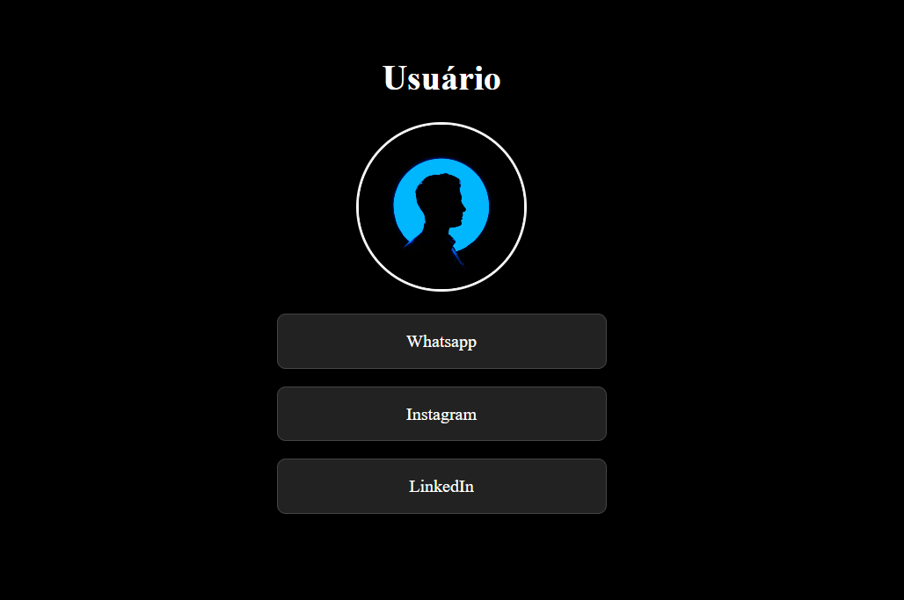
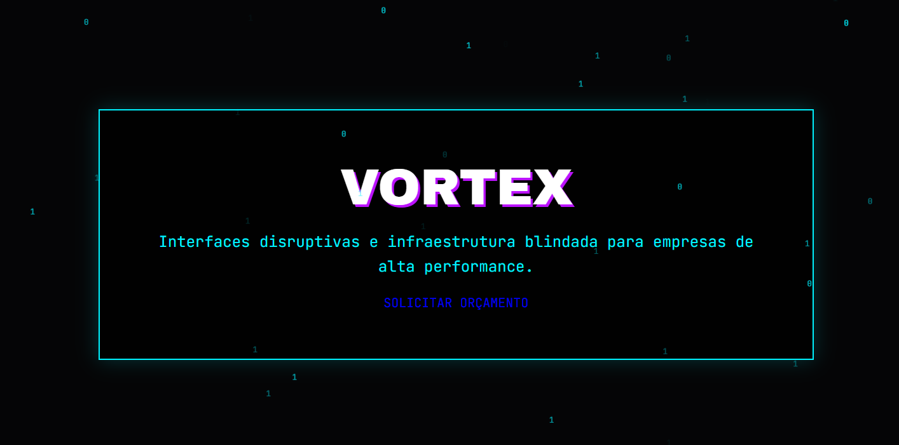
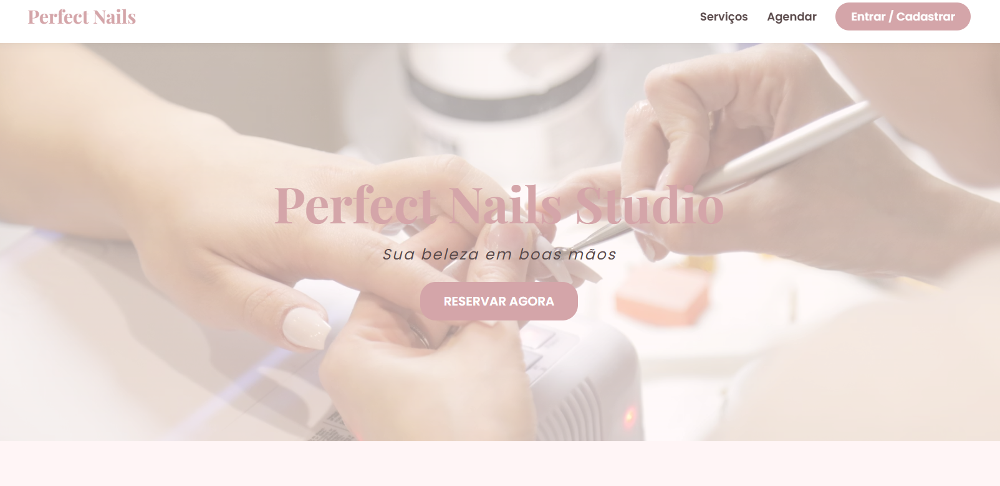
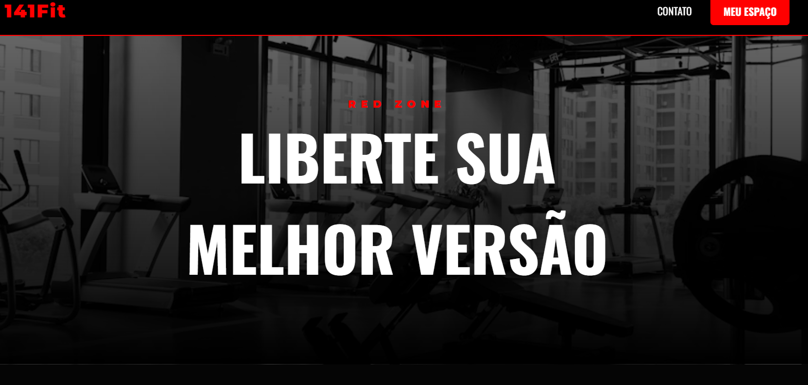

<div align="center">


<a href="https://portfolio-debora-martins.vercel.app" target="_blank">
  
</a>

<br/><br/>


</div>


## `> whoami`

```js
const debora = {
  nome: "Débora Martins",
  origem: "Área administrativa",
  missao: "Transição para Desenvolvimento de Sistemas",
  foco: ["Front-End", "UI/UX"],
  estudando: ["HTML5", "CSS3 (Flexbox/Grid)", "JavaScript", "Lógica de programação"],
  proximaParada: "Full Stack + Automação",
  lema: "Aprender sempre, inovar e entregar qualidade 💜"
};
```

> 💡 Levo para o código a organização, a atenção aos detalhes e a visão de processos que construí na rotina administrativa.


## 🚀 `> projetos --destaque`

<p align="center">Interfaces criadas na minha transição para o Front-End. Clique para ver ao vivo!</p>

<table align="center">
  <tr>
    <td align="center">
      <a href="https://my-link-tree-sigma.vercel.app/" target="_blank">
        <br />
        <b>🔗 My Link Tree</b><br/>
        <sub>Ver projeto →</sub>
      </a>
    </td>
    <td align="center">
      <a href="https://vortex-interface.vercel.app/" target="_blank">
        <br />
        <b>🌀 Vortex Interface</b><br/>
        <sub>Ver projeto →</sub>
      </a>
    </td>
  </tr>
  <tr>
    <td align="center">
      <a href="https://perfect-nails-interface.vercel.app/" target="_blank">
        <br />
        <b>💅 Studio Nails Design</b><br/>
        <sub>Ver projeto →</sub>
      </a>
    </td>
    <td align="center">
      <a href="https://gym-141-fit-interface.vercel.app/" target="_blank">
        <br />
        <b>🏋️ 141Fit-RedZone</b><br/>
        <sub>Ver projeto →</sub>
      </a>
    </td>
  </tr>
</table>


## 🛠️ `> stack --list`

<div align="center">

<a href="https://skillicons.dev">
  
</a>

<br/><br/>


</div>


## 📊 `> stats --live`

<div align="center">


<br/>


</div>


## 🤝 `> contato --abrir`

<div align="center">

Quer trocar ideias sobre tecnologia, projetos ou oportunidades?
Abra uma **Issue** aqui no meu perfil ou me mencione com **@deboramartins-svg** 💜
